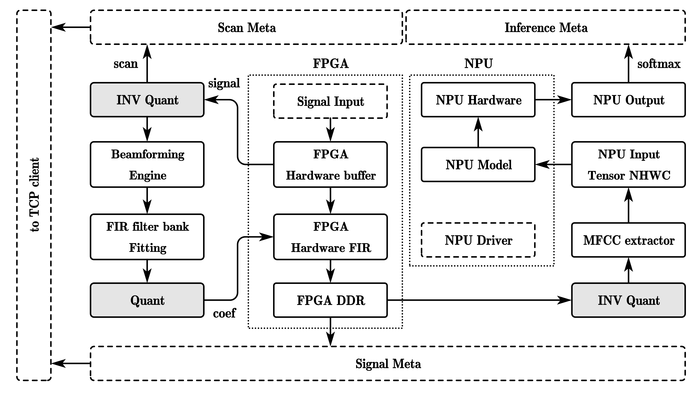

# VUPRS Server

[](https://isocpp.org/) [](https://cmake.org/) []()

<div align="center">

English | [简体中文](docs/README_cn.md)

</div>

VUPRS Server is the Linux server component of an under-vehicle acoustic fault localization and recognition system. It runs on an **RK3568 (ARM64)** SoC, exchanges data with an on-board **XC7A100T (Artix-7) FPGA** over **XDMA**, performs multi-channel acoustic acquisition, broadband beamforming and FIR filtering, runs **RKNN NPU** fault inference, and exposes a single-port TCP command/data service.

The FPGA handles the deterministic data path (acquisition, pre-delay, FIR filtering, DMA); the RK3568 estimates the spatial covariance, computes beamforming weights and FIR coefficients, writes them back to the FPGA, and publishes beamforming, scan and inference data to network clients.

<div align="center">
  
</div>

Related project: [vuprs-support](https://github.com/ShixuanLiu9527/vuprs-support.git)

## Features

- **FPGA data acquisition** — AXI-Lite register access and AXI-Stream/DDR transfers over XDMA.
- **Broadband beamforming**
  - pluggable `CBF`, `MVDR` and `DCRCB` algorithms behind a persistent `BeamFormingEngine`;
  - the engine owns the array, signal history, covariance matrices, scan state and FIR filter bank;
  - switching algorithms keeps the covariance matrix warm, so a new algorithm starts from a converged estimate instead of restarting the snapshot count;
  - array geometry is loaded from JSON and normalized to ADC channel order (`A1`–`A8`, `B1`–`B8`).
- **FIR filter bank** — expected frequency response synthesized from the beamforming weights with FFTW3, converted to FIR coefficients and issued to the FPGA.
- **Scan mode** — rate-limited covariance snapshots, CBF power-map calculation and normalized scan-frame publication.
- **Fault detection and recognition** — feature extraction, RKNN NPU inference and post-processing.
- **Network service** — single TCP port with framed JSON control messages and binary data streams for beamforming results, scan maps and inference tensors; bounded queues and drop policies protect the real-time path.
- **Debugging tools** — `fpga_tool` for register/memory access, plus a host-buildable mock server and network test suite.

## Architecture

| Layer | Responsibility |
| :--- | :--- |
| FPGA (`XC7A100T`) | ADC acquisition, pre-delay, FIR filter bank, DMA buffers |
| XDMA driver | PCIe enumeration, AXI-Lite/stream access, interrupt delivery |
| VUPRS server (`RK3568`) | Signal processing, beamforming, inference, TCP service |
| Network clients | Control commands and binary telemetry consumers |

Processing pipeline:

1. **Acquisition** — the circular-buffer thread reads a fixed-size multi-channel frame from the FPGA and converts it to `SignalData` (16 ADC channels).
2. **Beamforming** — `BeamFormingEngine` ingests the frame, updates the spatial covariance matrix, computes per-frequency weights and synthesizes the FIR filter bank.
3. **Hardware feedback** — pre-delay values and FIR coefficients are written back to the FPGA.
4. **Inference** — beamformed result frames feed the feature extractor and RKNN model; tensors are published when ready and rate-limited.
5. **Scan** — when enabled, covariance snapshots are converted to a normalized power map and streamed at a limited rate.
6. **Networking** — control requests and binary data frames are multiplexed over a single TCP session.

## Repository Layout

```text
├── 3rdparty/     # Vendored: Asio, Eigen, FFTW3, nlohmann/json, RKNN Runtime, spdlog
├── algo/
│   ├── bf/       # Beamforming engine, array model, CBF/MVDR/DCRCB algorithms, FIR filter bank
│   ├── detector/ # Fault detection orchestration
│   ├── dsp/      # FFTW3 wrappers and signal-processing helpers
│   ├── inference/# Feature extraction, RKNN launcher, post-processing
│   └── utils/    # Shared math utilities (iterative solvers, decomposition, scan grids)
├── cmake/        # Cross-compilation toolchain
├── configs/      # JSON configuration templates
├── docs/         # Build guide, protocol, FPGA tool and Chinese README
├── fpga/         # XDMA device abstraction and data conversion; cli/ hosts fpga_tool
├── hybrid/       # FPGA + ARM beamformer orchestration
├── logger/       # Logging and runtime checks
├── misc/         # Aligned buffers, thread pool, file/string utilities, rate limiter
├── pcie/         # XDMA kernel driver sources
├── scripts/      # Board setup and launch scripts
├── server/
│   ├── net/      # Standalone Asio network layer
│   └── test/     # Mock server and network tests
├── build.sh      # Driver + server + tool build script
├── CMakeLists.txt
└── main.cpp      # Server entry point
```

## Requirements

- **Target**: Linux on RK3568 (ARM64), kernel sources and build environment for the XDMA driver.
- **Host**: Linux x86_64 with CMake **>= 3.10** and a C++17-capable aarch64 cross toolchain.
- **Dependencies**: Asio, Eigen, FFTW3, nlohmann/json, RKNN Runtime and spdlog are vendored under `3rdparty/`; no system installation is required.
- **Hardware**: XC7A100T FPGA with the VUPRS bitstream, XDMA-capable PCIe link and a network interface for clients.

## Build

1. Set the compiler paths in [`cmake/rk3568_toolchain.cmake`](./cmake/rk3568_toolchain.cmake).
2. Set `XDMA__ARCH`, `XDMA__CROSS_COMPILE` and `XDMA__KERNEL_DIR` in [`build.sh`](./build.sh).
3. Build:

```bash
sudo sh ./build.sh all       # XDMA driver + server + FPGA tool
sudo sh ./build.sh xdma      # driver only
sudo sh ./build.sh server    # server + FPGA tool only
```

Other commands: `clean-all`, `clean-xdma`, `clean-server` and `help`.

Artifacts are written to `build/` (`server`, `fpga/cli/fpga_tool`, `xdma/xdma.ko`, `3rdparty/fftw3/`). See [Build & Usage](docs/build_and_usage.md) for a complete walkthrough.

## Deployment

```bash
sudo sh ./scripts/create_run_dir.sh          # generate vuprs/ runtime directory
# place the model at vuprs/model/model.rknn
sudo sh ./net_config.sh                      # configure the board network (optional)
cd vuprs/ && sudo sh ./run_server.sh         # start as root
```

`create_run_dir.sh` packages the server, `xdma.ko`, FFTW/RKNN libraries, configs and `run_server.sh` into `vuprs/`. The model path is configured in `configs/rknn_config.json`. `run_server.sh` loads `xdma.ko`, sets `LD_LIBRARY_PATH`, and passes the seven configuration files to the server.

## Configuration

| File | Purpose |
| :--- | :--- |
| `fpga_config.json` | FPGA bus addresses, DMA and register layout |
| `server_config.json` | TCP port, payload limit and queue depths |
| `array_config.json` | Microphone array geometry and ADC channel assignment |
| `fir_config.json` | FIR filter parameters |
| `rknn_config.json` | Inference frequency range, frame time and model path |
| `hybrid_default_config.json` | Sampling rate, target direction, wave velocity, DMA buffers |
| `logger_config.json` | Log output directories |

## Network Protocol

The server uses a single TCP port with a framed protocol: JSON control commands and binary data streams for beamforming results, scan maps and inference tensors. See [Protocol](docs/protocol_cmd.md) for the complete command set, error codes and payload layouts.

## FPGA Debug Tool

Mount the XDMA driver and use `fpga_tool` to read/write FPGA registers and memory:

```bash
sudo sh ./mount_xdma.sh
```

See [FPGA Tool Usage](docs/ug-fpga-tool.md) for details.

## Documentation

- [Build and Usage Guide](docs/build_and_usage.md)
- [Network Protocol](docs/protocol_cmd.md)
- [FPGA Tool Manual](docs/ug-fpga-tool.md)

---
_Shixuan Liu 2025_
