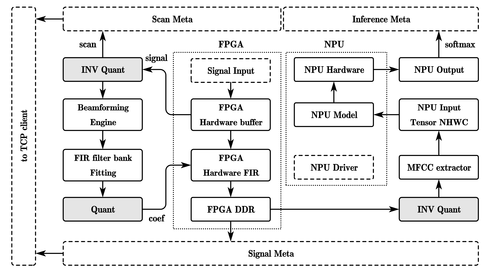

# VUPRS Server

<div align="center">

[English](../README.md) | 简体中文

</div>

VUPRS Server 是车下故障声学定位与识别系统的 Linux 服务器端。程序运行于 **RK3568 (ARM64)** 平台，通过 **XDMA** 与板载 **XC7A100T (Artix-7) FPGA** 进行数据交互，完成多通道声学信号采集、宽带波束形成与 FIR 滤波，并运行 **RKNN NPU** 故障推理，通过单端口 TCP 服务对外提供控制与数据接口。

FPGA 负责确定性数据通路（采集、预延迟、FIR 滤波、DMA）；RK3568 负责估计空间协方差、计算波束形成权重与 FIR 系数并写回 FPGA，同时通过 TCP 向网络客户端发布波束形成、扫描与推理数据。

<div align="center">
  
</div>

相关仓库：[vuprs-support](https://github.com/ShixuanLiu9527/vuprs-support.git)

## 主要特性

- **FPGA 数据采集** — 基于 XDMA 的 AXI-Lite 寄存器访问与 AXI-Stream/DDR 数据传输。
- **宽带波束形成**
  - 支持 `CBF`、`MVDR`、`DCRCB` 三种可插拔算法，由常驻的 `BeamFormingEngine` 统一管理；
  - 引擎持有阵列、信号历史、协方差矩阵、扫描状态和 FIR 滤波器组；
  - 切换算法时保留协方差矩阵，新算法从已收敛的估计开始，无需重新累积快照；
  - 阵列几何从 JSON 加载，并归一化为 ADC 通道顺序（`A1`–`A8`、`B1`–`B8`）。
- **FIR 滤波器组** — 根据波束形成权重生成期望频率响应，经 FFTW3 转换为 FIR 系数并下发 FPGA。
- **扫描模式** — 限速的协方差快照、CBF 功率图计算与归一化扫描帧发布。
- **故障检测与识别** — 特征提取、RKNN NPU 推理与后处理。
- **网络服务** — 单 TCP 端口，JSON 控制消息与二进制数据流（波束形成结果、扫描图、推理 tensor）；有界队列与丢弃策略保护实时路径。
- **调试工具** — `fpga_tool` 寄存器/内存访问工具，以及可在主机上独立构建的 mock server 和网络测试。

## 架构

| 层次 | 职责 |
| :--- | :--- |
| FPGA (`XC7A100T`) | ADC 采集、预延迟、FIR 滤波器组、DMA 缓冲 |
| XDMA 驱动 | PCIe 枚举、AXI-Lite/Stream 访问、中断投递 |
| VUPRS 服务器 (`RK3568`) | 信号处理、波束形成、推理、TCP 服务 |
| 网络客户端 | 控制命令与二进制遥测消费者 |

处理流程：

1. **采集** — 环形缓冲线程从 FPGA 读取定长多通道帧，并转换为 `SignalData`（16 个 ADC 通道）。
2. **波束形成** — `BeamFormingEngine` 输入信号、更新空间协方差矩阵、计算各频点权重并生成 FIR 滤波器组。
3. **硬件回写** — 将预延迟值与 FIR 系数写回 FPGA。
4. **推理** — 波束形成结果帧送入特征提取器与 RKNN 模型；tensor 在就绪后限速发布。
5. **扫描** — 开启后，协方差快照转换为归一化功率图并限速推送。
6. **网络** — 控制请求与二进制数据帧在单一 TCP 会话中复用。

## 目录结构

```text
.
├── 3rdparty/     # 内置依赖: Asio, Eigen, FFTW3, nlohmann/json, RKNN Runtime, spdlog
├── algo/
│   ├── bf/       # 波束形成引擎、阵列模型、CBF/MVDR/DCRCB 算法、FIR 滤波器组
│   ├── detector/ # 故障检测调度
│   ├── dsp/      # FFTW3 封装与信号处理工具
│   ├── inference/# 特征提取、RKNN 启动器、后处理
│   └── utils/    # 数学工具（迭代求解、矩阵分解、扫描网格等）
├── cmake/        # 交叉编译工具链
├── configs/      # JSON 配置模板
├── docs/         # 构建指南、协议、FPGA 工具及中文 README
├── fpga/         # XDMA 设备抽象与数据转换；cli/ 下为 fpga_tool
├── hybrid/       # FPGA + ARM 混合波束形成调度
├── logger/       # 日志与运行时检查
├── misc/         # 对齐缓冲、线程池、文件/字符串工具、限速器
├── pcie/         # XDMA 内核驱动源码
├── scripts/      # 板端配置与启动脚本
├── server/
│   ├── net/      # Standalone Asio 网络层
│   └── test/     # Mock server 与网络测试
├── build.sh      # 驱动 + 服务器 + 工具构建脚本
├── CMakeLists.txt
└── main.cpp      # 服务器入口
```

## 环境依赖

- **目标平台**：RK3568 (ARM64) Linux，具备 XDMA 驱动所需的内核源码与构建环境。
- **开发机**：Linux x86_64，CMake **>= 3.10**，支持 C++17 的 aarch64 交叉工具链。
- **依赖库**：Asio、Eigen、FFTW3、nlohmann/json、RKNN Runtime、spdlog 已内置于 `3rdparty/`，无需系统安装。
- **硬件**：运行 VUPRS 比特流的 XC7A100T FPGA、支持 XDMA 的 PCIe 链路，以及客户端网络接口。

## 构建

1. 在 [`cmake/rk3568_toolchain.cmake`](../cmake/rk3568_toolchain.cmake) 中设置交叉编译器路径。
2. 在 [`build.sh`](../build.sh) 中设置 `XDMA__ARCH`、`XDMA__CROSS_COMPILE`、`XDMA__KERNEL_DIR`。
3. 编译：

```bash
sudo sh ./build.sh all       # XDMA 驱动 + 服务器 + FPGA 工具
sudo sh ./build.sh xdma      # 仅 XDMA 驱动
sudo sh ./build.sh server    # 仅服务器 + FPGA 工具
```

其他命令：`clean-all`、`clean-xdma`、`clean-server`、`help`。

构建产物位于 `build/`（`server`、`fpga/cli/fpga_tool`、`xdma/xdma.ko`、`3rdparty/fftw3/`）。完整流程见 [构建与使用](build_and_usage.md)。

## 部署

```bash
sudo sh ./scripts/create_run_dir.sh          # 生成 vuprs/ 运行目录
# 将模型放到 vuprs/model/model.rknn
sudo sh ./net_config.sh                      # 配置板端网络（可选）
cd vuprs/ && sudo sh ./run_server.sh         # 以 root 权限启动
```

`create_run_dir.sh` 会把服务器、`xdma.ko`、FFTW/RKNN 动态库、配置文件和 `run_server.sh` 打包到 `vuprs/`。模型路径由 `configs/rknn_config.json` 配置。`run_server.sh` 会加载 `xdma.ko`、设置 `LD_LIBRARY_PATH`，并把 7 个配置文件传给服务器。

## 配置

| 文件 | 说明 |
| :--- | :--- |
| `fpga_config.json` | FPGA 总线地址、DMA 与寄存器布局 |
| `server_config.json` | TCP 端口、最大负载与队列长度 |
| `array_config.json` | 麦克风阵列坐标与 ADC 通道分配 |
| `fir_config.json` | FIR 滤波器参数 |
| `rknn_config.json` | 推理频率范围、帧时长与模型路径 |
| `hybrid_default_config.json` | 采样率、目标指向、声速、DMA 缓冲等默认参数 |
| `logger_config.json` | 日志输出目录 |

## 网络协议

服务器使用单 TCP 端口的帧式协议：JSON 控制命令，以及波束形成结果、扫描图与推理 tensor 的二进制数据流。完整命令集、错误码与负载格式见 [协议](protocol_cmd.md)。

## FPGA 调试工具

先加载 XDMA 驱动，再使用 `fpga_tool` 读写 FPGA 寄存器与内存：

```bash
sudo sh ./mount_xdma.sh
```

详细用法见 [FPGA 工具使用说明](ug-fpga-tool.md)。

## 文档

- [构建与使用指南](build_and_usage.md)
- [网络协议](protocol_cmd.md)
- [FPGA 工具手册](ug-fpga-tool.md)

---
_Shixuan Liu 2025_
